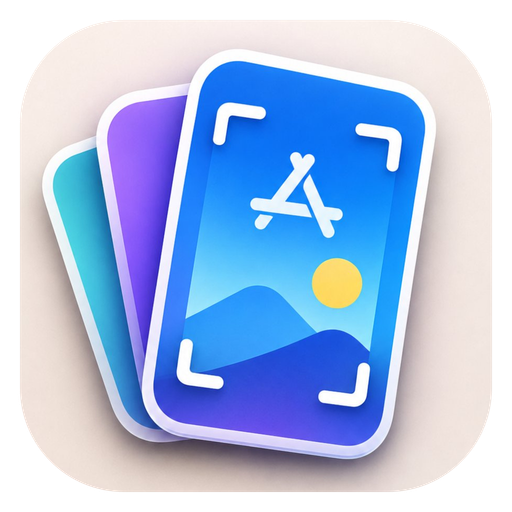
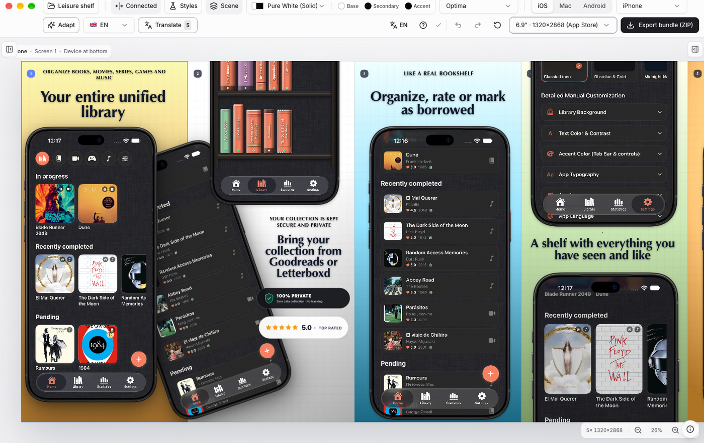
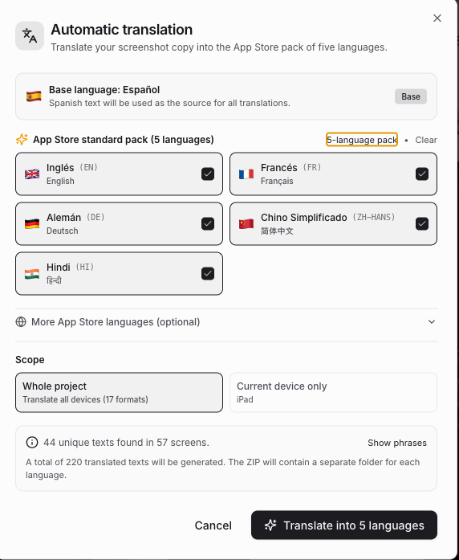
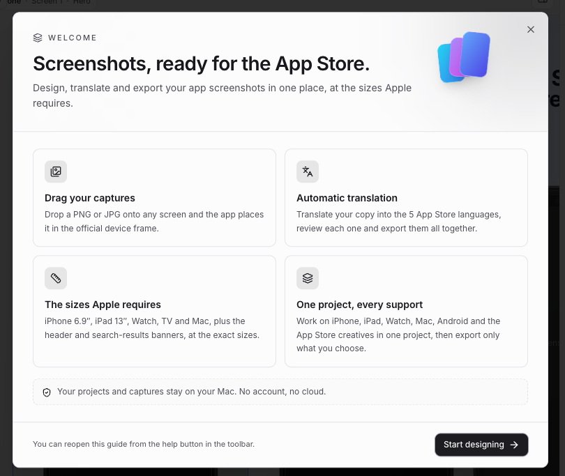

# Simply a screenshot app

Editor de escritorio para macOS para diseñar, localizar y exportar conjuntos de capturas de App Store y Google Play.

[English](README.md) | Español

> Traducción de [README.md](README.md). La documentación principal está en inglés.

---

## Apoyar

[](https://ko-fi.com/T6T81KZ93F)

Si esta app te ahorra tiempo, puedes invitarme a un café.

---

## Descargar

[Descarga la última versión](https://github.com/paoloacx/simply-a-screenshot-app/releases/latest) para macOS 12 o posterior (Apple Silicon).

1. Abre el `.dmg` y arrastra **Simply a screenshot app** a Aplicaciones.
2. Ábrela. La app está firmada con Developer ID y notarizada por Apple, así que Gatekeeper la abre sin pasos extra.

---


[](https://nextjs.org/)
[](https://react.dev/)
[](https://www.typescriptlang.org/)
[](https://tailwindcss.com/)
[](https://www.electronjs.org/)
[](https://apple.com)
[](LICENSE)

---

<p align="center">
  
</p>

## Capturas

<p align="center">
  
</p>
<p align="center">
  
  
</p>

---

## Descripción

Simply a screenshot app genera conjuntos de capturas listos para publicar a
partir de las capturas de la aplicación y sus textos. Incluye un lienzo de diseño
conectado, los marcos de dispositivo y los tamaños de exportación que exigen
App Store Connect y Google Play, y un almacén local de proyectos.

La aplicación está construida con Electron y Next.js y se ejecuta íntegramente en
el equipo local. Los proyectos, las capturas y las fuentes se guardan en la
carpeta Application Support del usuario; no requiere cuenta ni servicio remoto.

## Funciones

- **Lienzo.** Pantallas conectadas o aisladas, capturas arrastradas, orden de
  capas, alineación y diseños por pantalla.
- **Dispositivos.** iPhone 6.9", iPad 13", iPhone Duo, Apple TV, Apple Watch,
  CarPlay, Mac, móviles y tablets Android, gráfico destacado de Google Play y
  recursos creativos de App Store. Los marcos de Apple están incluidos.
- **Localización.** Textos por idioma, traducción mediante el servicio público
  de Google (requiere internet; no es una API oficial) y revisión de cada idioma
  antes de exportar.
- **Estilo.** Temas, paletas, degradados, texturas, fuentes incluidas e
  importadas, escenas y capas de imagen.
- **Proyectos.** Varios proyectos con guardado automático, importación y
  exportación.
- **Exportación.** Un tamaño seleccionado por dispositivo, con el tamaño exigido
  por la tienda como valor predeterminado; todos los idiomas configurados en un
  único ZIP.
- **Subidas.** Las capturas se guardan como WebP q92 (visualmente sin pérdida);
  el límite de subida es de 20 MB.
- **Adaptación entre dispositivos.** Reutiliza un diseño en otros dispositivos
  conservando textos, traducciones, colores y recursos.
- **Integración con macOS.** Ventana nativa y menús del sistema, instancia única
  y guardado pendiente antes de cerrar.

## Requisitos

- macOS 12 o posterior. La compilación empaquetada es para Apple Silicon.
- Node.js 20.9 o posterior y npm para desarrollar.

## Desarrollo

```bash
npm install
npm run dev
```

## Compilación

```bash
npm run build:mac
```

El instalador se genera en `../Instalador/`:

```text
../Instalador/Simply a screenshot app-1.0.0-arm64.dmg
```

`npm run clean` elimina los artefactos de compilación sin tocar el instalador ni
los datos del usuario.

La compilación firma con el certificado Developer ID del llavero y notariza
automáticamente cuando hay credenciales de Apple en el entorno.

## Datos

Los proyectos, las capturas subidas y las fuentes importadas se guardan en:

```text
~/Library/Application Support/Simply a screenshot app/data/
```

La carpeta está fuera del repositorio y se conserva al reinstalar. Para guardar
una copia de un proyecto, usa el gestor de proyectos o copia su archivo JSON.

## Estructura del proyecto

```text
simply-a-screenshot-app/
├── electron/                     # Proceso principal, puente y gestor de caché
├── build/                        # Icono, fondo del DMG y entitlements
├── public/                       # Marcos, fuentes e insignias
├── src/
│   ├── app/                      # Rutas de Next.js y API
│   ├── components/editor/        # Lienzo, barra superior, inspector y diálogos
│   └── lib/                      # Estado, almacenamiento, exportación y dominio
├── docs/                         # Capturas e icono
├── electron-builder.config.js    # Compilación, firma y notarización
├── electron-builder.base.json    # Ajustes compartidos de compilación
├── next.config.mjs               # Configuración de Next.js
└── package.json                  # Dependencias y scripts
```

## Scripts

- `npm run dev` — inicia el servidor de desarrollo.
- `npm run build` — genera la compilación de producción de Next.js.
- `npm run start` — sirve la compilación de producción.
- `npm run typecheck` — comprueba los tipos de TypeScript.
- `npm run electron:dev` — ejecuta la app en una ventana de Electron durante el desarrollo.
- `npm run build:mac` — compila, firma y empaqueta el DMG para Apple Silicon.
- `npm run clean` — elimina los artefactos de compilación.

## Licencia

MIT. Consulta [LICENSE](LICENSE).
