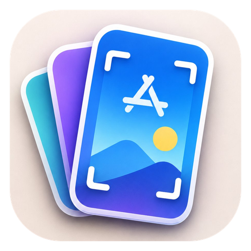
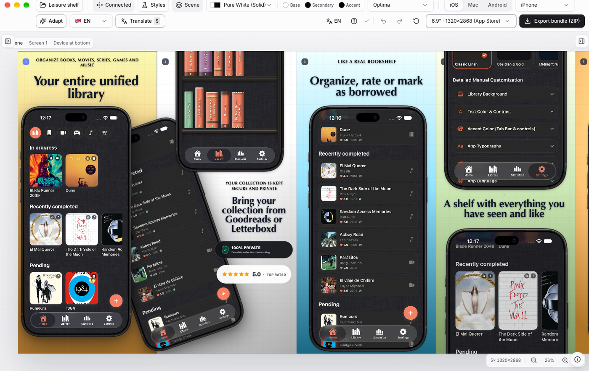
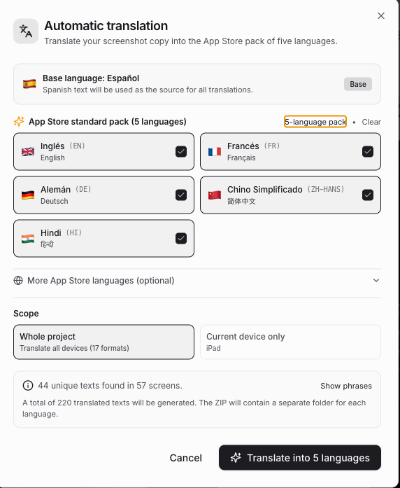
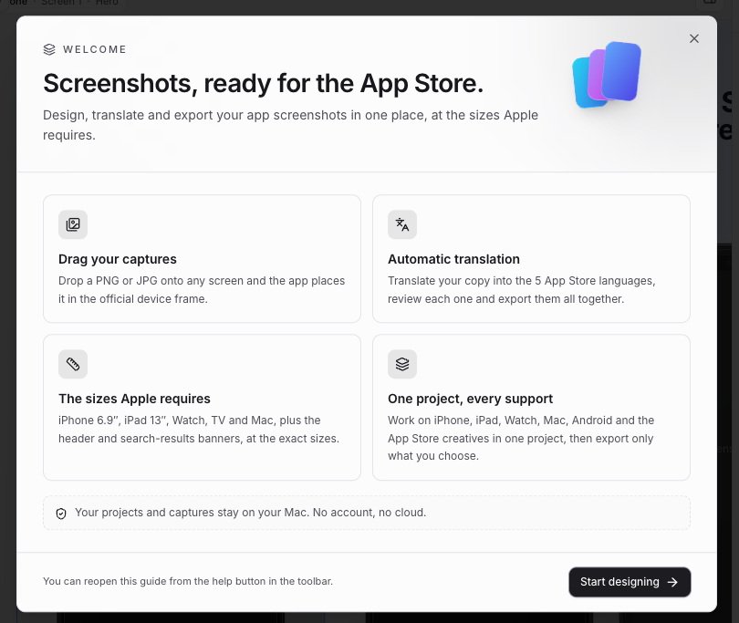

# Simply a screenshot app

A macOS desktop editor for designing, localizing and exporting App Store and Google Play screenshot sets.

English | [Español](README.es.md)

---

## Support

[](https://ko-fi.com/T6T81KZ93F)

If this app saves you time, you can buy me a coffee.

---

## Download

[Download the latest release](https://github.com/paoloacx/simply-a-screenshot-app/releases/latest) for macOS 12 or later (Apple Silicon).

1. Open the `.dmg` and drag **Simply a screenshot app** to Applications.
2. Launch it. The app is signed with a Developer ID and notarized by Apple, so Gatekeeper opens it without extra steps.

---


[](https://nextjs.org/)
[](https://react.dev/)
[](https://www.typescriptlang.org/)
[](https://tailwindcss.com/)
[](https://www.electronjs.org/)
[](https://apple.com)
[](LICENSE)

---

<p align="center">
  
</p>

## Screenshots

<p align="center">
  
</p>
<p align="center">
  
  
</p>

---

## Overview

Simply a screenshot app produces store-ready screenshot sets from app captures
and copy. It provides a connected design canvas, the device frames and export
sizes required by App Store Connect and Google Play, and a local project store.

The application is built with Electron and Next.js and runs entirely on the
local machine. Projects, captures and fonts are stored in the user's Application
Support directory; no account or remote service is required.

## Capabilities

- **Canvas.** Connected or isolated screens, drag-and-drop captures, layer
  ordering, alignment and per-slide layouts.
- **Devices.** iPhone 6.9", iPad 13", iPhone Duo, Apple TV, Apple Watch,
  CarPlay, Mac, Android phones and tablets, Google Play feature graphic and App
  Store creative assets. Apple's device bezels are bundled.
- **Localization.** Per-locale copy, translation through Google's public
  endpoint (internet required; not an official API) and per-locale review before
  export.
- **Styling.** Themes, palettes, gradients, textures, bundled and imported fonts,
  scenes and image overlays.
- **Projects.** Multiple projects with automatic saving, import and export.
- **Export.** One selected size per device, defaulting to the size required by
  the store; every configured locale in a single ZIP.
- **Uploads.** Captures are stored as WebP q92 (visually lossless); the upload
  limit is 20 MB.
- **Cross-device adaptation.** Reuse a design across devices while preserving
  copy, translations, colors and assets.
- **Desktop integration.** Native window and macOS menus, single-instance lock,
  and a save flush before closing.

## Requirements

- macOS 12 or later. The packaged build targets Apple Silicon.
- Node.js 20.9 or later and npm for development.

## Development

```bash
npm install
npm run dev
```

## Build

```bash
npm run build:mac
```

The installer is written to `../Instalador/`:

```text
../Instalador/Simply a screenshot app-1.0.0-arm64.dmg
```

`npm run clean` removes the build output without touching the installer or user
data.

The build signs with the Developer ID certificate in the login keychain and
notarizes automatically when Apple credentials are available in the environment.

## Data

Projects, uploaded captures and imported fonts are stored in:

```text
~/Library/Application Support/Simply a screenshot app/data/
```

The directory is outside the repository and survives reinstalls. Back up a
project through the project manager or by copying its JSON file.

## Project structure

```text
simply-a-screenshot-app/
├── electron/                     # Main process, preload bridge and cache handler
├── build/                        # Icon, DMG background and entitlements
├── public/                       # Frames, fonts and badges
├── src/
│   ├── app/                      # Next.js routes and API handlers
│   ├── components/editor/        # Canvas, toolbar, inspector, dialogs
│   └── lib/                      # State, storage, export and domain logic
├── docs/                         # Screenshots and icon
├── electron-builder.config.js    # Build, signing and notarization config
├── electron-builder.base.json    # Shared build settings
├── next.config.mjs               # Next.js configuration
└── package.json                  # Dependencies and scripts
```

## Scripts

- `npm run dev` — start the development server.
- `npm run build` — create the production Next.js build.
- `npm run start` — serve the production build.
- `npm run typecheck` — check TypeScript types.
- `npm run electron:dev` — run the app in an Electron window during development.
- `npm run build:mac` — build, sign and package the Apple Silicon DMG.
- `npm run clean` — remove build artifacts.

## License

MIT. See [LICENSE](LICENSE).
